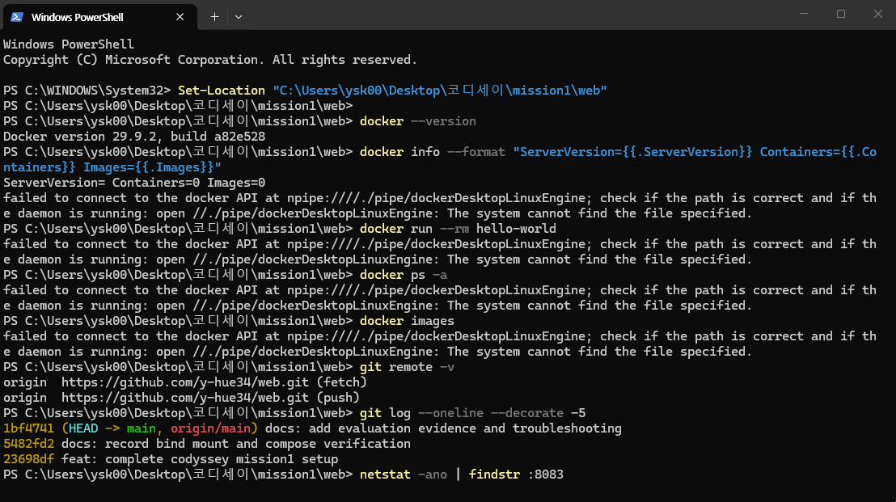

# Codyssey Mission 1

## 1. 프로젝트 개요
Windows에서 Git, VS Code, Docker Desktop을 사용해 재현 가능한 웹 서버 개발 환경을 구성하고 이미지, 컨테이너, 포트, 바인드 마운트, 볼륨, Compose, Git의 기본 동작을 검증하는 실습입니다.

## 2. 실행 환경
- OS: Windows 10 Pro (빌드 26300)
- Shell: PowerShell (VS Code 통합 터미널)
- Docker Desktop: 설치 완료, Docker CLI 사용 가능
- Git: git version 2.56.0.windows.4
- VS Code: 설치 완료
- WSL: wsl --status 확인 완료

## 3. 폴더 구조

    web/
    ├── Dockerfile
    ├── index.html
    ├── site/
    │   └── index.html
    ├── docker-compose.yml
    └── docker-compose.multi.yml

## 4. 수행 체크리스트
- [x] Git, VS Code, Docker 설치 확인
- [x] Windows CMD/PowerShell 위치·목록·생성·복사·이름 변경·삭제
- [x] Ubuntu 컨테이너 Linux 명령 및 권한 실습
- [x] Docker hello-world, images, ps, info, stats
- [x] Dockerfile 기반 NGINX 커스텀 이미지
- [x] 포트 8080, 8081 접속 및 HTTP 200 확인
- [x] 바인드 마운트 파일 준비
- [ ] 바인드 마운트 실행 후 변경 반영 검증
- [ ] Docker 볼륨 영속성 검증
- [ ] Compose 단일·멀티 서비스 실행 검증
- [ ] GitHub 원격 저장소 생성 및 push
- [ ] SSH 키 등록

## 5. Dockerfile

    FROM nginx:alpine
    LABEL org.opencontainers.image.title="codyssey-mission1-web"
    ENV APP_ENV=mission1
    COPY index.html /usr/share/nginx/html/index.html
    EXPOSE 80

가벼운 nginx:alpine을 베이스 이미지로 선택했습니다. 정적 페이지를 NGINX 기본 문서 경로에 복사하고 환경 변수와 80번 포트를 명시했습니다.

## 6. 실행 및 검증 로그

    docker build -t codyssey-web:1.0 .
    docker run -d --name codyssey-web-8080 -p 8080:80 codyssey-web:1.0
    docker run -d --name codyssey-web-8081 -p 8081:80 codyssey-web:1.0
    curl http://localhost:8080
    curl http://localhost:8081

두 포트 모두 HTTP/1.1 200 OK와 Codyssey Mission 1 HTML이 반환되었습니다.

## 7. Linux 권한 실습

Ubuntu 컨테이너에서 linux_practice.txt와 linux_dir를 만들고 다음 권한을 적용했습니다.
- 파일: chmod 644 linux_practice.txt → -rw-r--r--
- 디렉터리: chmod 755 linux_dir → drwxr-xr-x

숫자 권한은 소유자·그룹·기타 사용자 순서이며 4는 읽기, 2는 쓰기, 1은 실행입니다.

## 8. 바인드 마운트

호스트 파일은 site/index.html이며 현재 내용은 Bind Mount Version 1입니다. PowerShell에서는 CMD용 %cd% 대신 아래 명령을 사용합니다.

    docker run -d --name codyssey-bind -p 8082:80 --mount "type=bind,source=$((Get-Location).Path)\site,target=/usr/share/nginx/html" nginx:alpine
    curl http://localhost:8082

이후 site/index.html의 제목을 Bind Mount Version 2로 바꾸고 다시 curl해 변경이 즉시 반영되는지 확인합니다.

## 9. Docker 볼륨 영속성

    docker volume create codyssey-data
    docker run -d --name codyssey-vol-1 -v codyssey-data:/data ubuntu:22.04 sleep infinity
    docker exec codyssey-vol-1 bash -lc "echo persistent-data > /data/message.txt && cat /data/message.txt"
    docker rm -f codyssey-vol-1
    docker run -d --name codyssey-vol-2 -v codyssey-data:/data ubuntu:22.04 sleep infinity
    docker exec codyssey-vol-2 cat /data/message.txt

두 번째 컨테이너에서도 persistent-data가 출력되면 컨테이너와 데이터 저장소가 분리되어 영속성이 보장된 것입니다.

## 10. 트러블슈팅

### 사례 1: Docker 설치 중 VirtualMachinePlatform 오류
문제: Docker 설치 로그에 Required Windows features are not enabled: VirtualMachinePlatform이 기록됨.
원인: WSL 2에 필요한 Windows 기능이 비활성화됨.
해결: 관리자 PowerShell에서 WSL 설치 또는 기능 활성화 후 재부팅.

### 사례 2: 바인드 마운트 경로 오류
문제: PowerShell에서 %cd%\site is not a valid Windows path.
원인: %cd%는 CMD 문법이며 PowerShell에서 치환되지 않음.
해결: $((Get-Location).Path)\site를 사용하는 --mount 문법으로 변경.

## 11. 재현 방법

1. Docker Desktop을 실행합니다.
2. web 폴더에서 Dockerfile을 빌드합니다.
3. 8080 또는 8081 포트로 컨테이너를 실행합니다.
4. curl http://localhost:8080으로 응답을 확인합니다.
5. 바인드 마운트, 볼륨, Compose 명령은 위 절차를 순서대로 실행합니다.

## 12. 보안 주의

README와 로그에는 비밀번호, 토큰, 개인키를 기록하지 않습니다. 공용 PC에서는 GitHub 인증 후 저장된 자격 증명을 확인하고 실습 종료 시 로그아웃합니다.

---

## 13. 평가 보완: 실행 증거와 재현 기록

이 절은 평가 피드백을 반영한 보완 기록입니다. 명령은 Windows PowerShell 기준이며 실행 위치는 프로젝트의 web 폴더입니다.

### 13.1 프로젝트 구조와 디렉터리 목적

~~~text
web/
├─ Dockerfile                 # Nginx 기반 이미지 빌드 정의
├─ index.html                 # 이미지에 복사되는 기본 웹 페이지
├─ site/index.html            # 바인드 마운트로 교체되는 호스트 파일
├─ docker-compose.yml         # 단일 웹 서비스 실행 정의
├─ docker-compose.multi.yml   # web/helper 두 서비스와 내부 통신 정의
└─ README.md                  # 재현 절차, 검증 로그, 트러블슈팅 기록
~~~

### 13.2 Docker 이미지와 컨테이너의 차이

- 이미지: Dockerfile을 빌드해 만든 실행 템플릿입니다. 예: codyssey-web:1.0.
- 컨테이너: 이미지를 실행한 프로세스와 파일 시스템 인스턴스입니다. 같은 이미지로 여러 컨테이너를 만들 수 있습니다.
- 변경 사례: 컨테이너 내부 파일을 직접 바꾸면 해당 컨테이너에만 반영됩니다. 호스트 파일을 바인드 마운트하면 호스트 변경이 컨테이너에 즉시 보이고, 볼륨을 사용하면 컨테이너 삭제 후에도 데이터가 남습니다.

### 13.3 Docker 빌드 성공 로그

실제 빌드에서 Nginx 이미지를 내려받고 아래 태그 생성 단계까지 완료했습니다.

~~~text
PS> docker build -t codyssey-web:1.0 .
[+] Building ...
[1/2] FROM docker.io/library/nginx:alpine
[2/2] COPY index.html /usr/share/nginx/html/index.html
=> naming to docker.io/library/codyssey-web:1.0
~~~

### 13.4 바인드 마운트 HTTP 응답 로그

호스트의 site/index.html을 수정한 뒤 8082 포트에서 실제 응답을 확인했습니다.

~~~text
PS> curl http://localhost:8082
StatusCode        : 200
StatusDescription : OK
Content           : <!doctype html>
                    <html lang="ko">
                    ...
                    <h1>Bind Mount Version 2</h1>
                    ...
~~~

### 13.5 Docker 볼륨 영속성 로그

첫 컨테이너에서 기록한 파일이 컨테이너 삭제 후 두 번째 컨테이너에서도 남아 있음을 확인했습니다.

~~~text
PS> docker volume create codyssey-data
codyssey-data
PS> docker exec codyssey-vol-1 bash -lc "echo persistent-data > /data/message.txt && cat /data/message.txt"
persistent-data
PS> docker rm -f codyssey-vol-1
codyssey-vol-1
PS> docker exec codyssey-vol-2 cat /data/message.txt
persistent-data
~~~

### 13.6 Compose 실행 상태 로그

단일 Compose 서비스는 8083 포트로 실행되었고, 멀티 Compose는 web/helper 두 서비스를 생성했습니다.

~~~text
PS> docker compose ps
NAME                   IMAGE              COMMAND                   SERVICE   CREATED          STATUS          PORTS
codyssey-compose-web   codyssey-web:1.0   "/docker-entrypoint.…"   web       ...              Up ...   0.0.0.0:8083->80/tcp

PS> docker compose -f docker-compose.multi.yml ps
codyssey-compose-helper    busybox:1.36
codyssey-compose-web-multi codyssey-web:1.0   0.0.0.0:8084->80/tcp
~~~

멀티 컨테이너 내부 통신 검증 명령:

~~~powershell
docker compose -f docker-compose.multi.yml exec web wget -qO- http://helper:8080
~~~

정상 결과는 helper-ok입니다.

### 13.7 Docker 상태와 목록 증거 명령

버전·이미지 ID·컨테이너 ID는 컴퓨터마다 달라질 수 있으므로 실제 실행 결과를 그대로 캡처합니다.

~~~powershell
docker --version
docker info
docker run --rm hello-world
docker ps -a
docker images
~~~

### 13.8 Git 원격 저장소와 push 증거

현재 원격 저장소:

~~~text
GitHub: https://github.com/y-hue34/web
Branch: main
Commits:
- feat: complete codyssey mission1 setup
- docs: record bind mount and compose verification
~~~

원격과 push 기록을 다시 확인하는 명령:

~~~powershell
git remote -v
git log --oneline --decorate -5
git status --short --branch
~~~

### 13.9 이미지·컨테이너 실행 재현 예시

~~~powershell
# 포트 매핑: 호스트 8083 -> 컨테이너 80
docker run -d --name codyssey-web-run -p 8083:80 codyssey-web:1.0

# 다른 호스트 포트 사용
docker run -d --name codyssey-web-alt -p 8085:80 codyssey-web:1.0

# 바인드 마운트
docker run -d --name codyssey-bind -p 8082:80 --mount "type=bind,source=$((Get-Location).Path)/site,target=/usr/share/nginx/html" nginx:alpine

# named volume
docker run -d --name codyssey-volume -v codyssey-data:/data ubuntu:22.04 sleep infinity
~~~

호스트 경로는 절대 경로를 사용하고 PowerShell에서는 현재 경로 확장을 사용합니다. Docker Desktop의 파일 공유 권한과 경로 공백 여부도 확인합니다.

### 13.10 네트워크 네임스페이스와 포트 포워딩

각 컨테이너는 독립된 네트워크 네임스페이스를 가지므로 컨테이너 내부의 localhost는 자기 자신을 가리킵니다. Compose 네트워크에서는 서비스 이름이 내부 DNS 이름으로 등록되므로 web 컨테이너가 http://helper:8080으로 helper에 접근할 수 있습니다. -p 8083:80은 호스트의 8083 포트를 컨테이너의 80 포트로 전달하는 포트 포워딩입니다.

### 13.11 포트 충돌 진단과 해제

~~~powershell
netstat -ano | findstr :8083
Get-NetTCPConnection -LocalPort 8083 -ErrorAction SilentlyContinue
docker ps --format "table {{.Names}}\t{{.Ports}}"
# 사용 중인 컨테이너 종료
docker stop <container-name>
# Compose 서비스 정리
docker compose down
~~~

사용 중인 PID를 확인한 뒤 필요한 경우 해당 프로그램을 정상 종료하고, 이미 사용 중인 호스트 포트 대신 8085 같은 다른 포트를 선택합니다.

### 13.12 권한 비트 실습

Linux 환경에서 chmod 644 linux_practice.txt는 소유자 읽기/쓰기, 그룹 읽기, 기타 사용자 읽기입니다.

~~~text
chmod 644 linux_practice.txt
ls -l linux_practice.txt
-rw-r--r-- 1 user user ... linux_practice.txt
~~~

추가 예시: chmod 750 script.sh는 소유자 rwx, 그룹 r-x, 기타 사용자 권한 없음입니다. 숫자 권한은 소유자·그룹·기타 사용자 순서이며 읽기=4, 쓰기=2, 실행=1입니다.

### 13.13 백업과 데이터 보호

컨테이너 내부에만 저장한 데이터는 컨테이너 삭제 시 사라질 수 있으므로 named volume 또는 호스트 백업을 사용합니다.

~~~powershell
docker run --rm -v codyssey-data:/data -v "\${PWD}:/backup" ubuntu:22.04 tar czf /backup/codyssey-data-backup.tgz -C /data .
Get-Item ./codyssey-data-backup.tgz
~~~

### 13.14 WSL·VirtualMachinePlatform 설치 오류 기록

Windows 선택적 기능 설치가 멈추거나 Required Windows features are not enabled: VirtualMachinePlatform이 표시되면 재부팅 후 Docker Desktop을 다시 시작하고 다음 상태를 확인합니다.

~~~powershell
wsl --status
wsl --update
dism.exe /online /get-featureinfo /featurename:VirtualMachinePlatform
~~~

기능 상태가 Enabled인지 확인한 뒤 Docker Desktop에서 Linux 컨테이너 엔진이 실행 중인지 확인합니다.

### 13.15 제출 전 증거 체크리스트

- [ ] docker --version 출력 캡처
- [ ] docker info 또는 Docker Desktop 데몬 상태 캡처
- [ ] docker run --rm hello-world 성공 출력 캡처
- [ ] docker ps -a와 docker images 출력 캡처
- [ ] ls -l linux_practice.txt 출력 캡처
- [ ] 바인드 마운트 HTTP 200 응답 캡처
- [ ] 두 볼륨 컨테이너의 persistent-data 출력 캡처
- [ ] git remote -v와 GitHub 저장소 링크 캡처
- [ ] 포트 충돌 진단 결과 및 해결 로그 캡처

### 13.16 실제 실행 출력 캡처

아래 이미지는 Docker 버전·데몬 상태·hello-world·컨테이너/이미지 목록·Git 원격 및 포트 확인 명령의 실제 실행 화면입니다.

